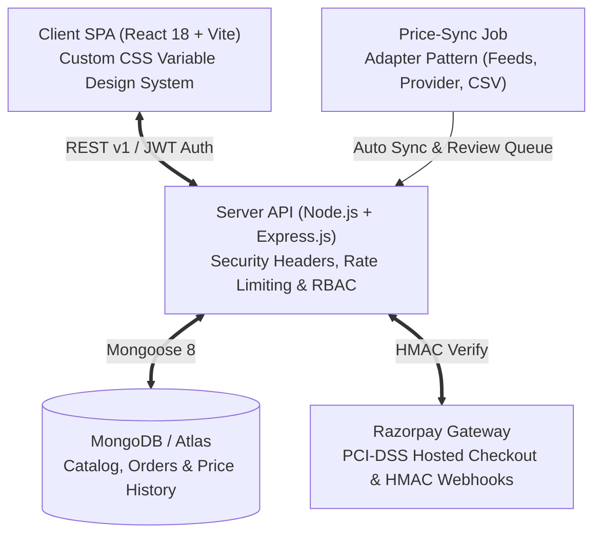

# 📱 MobiVerse India — Shop On Your Fingertips

[](https://github.com/sidda/mobileSite/actions/workflows/ci.yml)
[](https://nodejs.org/)
[](https://react.dev/)
[](https://vitejs.dev/)
[](https://www.mongodb.com/)
[](LICENSE)

> **MobiVerse India** is a production-quality, high-performance MERN marketplace where Indian consumers can browse, compare, and purchase every smartphone and accessory officially sold in India. It also connects buyers with authorized service providers for doorstep repairs, screen replacements, and verified trade-ins.

---

## 📑 Table of Contents

- [System Architecture](#-system-architecture)
- [Key Features by Role](#-key-features-by-role)
- [Tech Stack](#-tech-stack)
- [Monorepo Directory Structure](#-monorepo-directory-structure)
- [Getting Started](#-getting-started)
- [Environment Variables](#-environment-variables)
- [Demo & Seed Accounts](#-demo--seed-accounts)
- [Testing & Quality Assurance](#-testing--quality-assurance)
- [Documentation Links](#-documentation-links)

---

## 🏛 System Architecture



---

## 🚀 Key Features by Role

### 🛍 Customer & Visitor
- **Comprehensive Indian Catalogue**: 116+ real, verified Indian smartphones across 15+ brands (Samsung, Apple, OnePlus, Xiaomi/Redmi, Realme, Vivo, Oppo, Motorola, Nothing, Google, iQOO, Poco, Infinix, Tecno, Lava) with 696+ compatible accessories.
- **Accurate Indian Specs**: Display refresh rate, processor AnTuTu scores, camera sensors, 5G band support (Indian bands `n28`, `n78`), battery charging wattage, and in-the-box accessories.
- **Multi-Device Comparison Table**: Compare up to 4 phones side-by-side with sticky headers and difference highlighting.
- **Persistent Cart & Indian GST Breakup**: Live price computation directly from database records with transparent 18% GST calculation and free shipping threshold (> ₹999).
- **PCI-DSS Compliant Payments**: Razorpay hosted checkout supporting UPI, Credit/Debit cards, Net Banking, and Cash on Delivery (COD). **Zero card data is ever stored on the server.**
- **Doorstep Repairs & Services**: Book certified technician appointments for screen fixes and battery replacements across major Indian metros (Bengaluru, Mumbai, Delhi NCR, Hyderabad, Chennai, Pune).

### 🏪 Service Provider
- **Listing & Inventory Management**: Create and manage phone and accessory listings with real-time stock and price adjustments.
- **Service Bookings Dashboard**: View incoming repair requests and update status from booked to completed.
- **Order Tracking**: Monitor customer orders placed for products fulfilled by the provider.

### 🛡 Administrator
- **Catalogue Moderation Queue**: Review and approve listings submitted by service providers or auto-discovered by the sync engine.
- **Price-Sync Control Center**: Trigger on-demand sync jobs and view historical price movement logs.
- **User & Provider Management**: Verify service providers and manage customer privileges.
- **Marketplace Analytics**: High-level GMV, order volume, and active user metrics.

---

## 💻 Tech Stack

- **Frontend**: React 18, Vite, React Router 6, React Helmet Async (Dynamic SEO & JSON-LD Schemas), Axios with token refresh interceptor, Lucide React icons.
- **Styling**: Pure CSS3 Design System with CSS variables (`--color-primary: #2563EB`, `--color-accent: #F59E0B`, dark mode toggle via `data-theme`). **No heavy third-party UI frameworks.**
- **Backend**: Node.js 20+, Express.js 4.x.
- **Database**: MongoDB with Mongoose 8 (Automatic in-memory fallback via `mongodb-memory-server` for instant local setup).
- **Authentication**: JWT access tokens (15-min) + httpOnly, secure, sameSite refresh cookies, hashed with `bcryptjs` (work factor 12).
- **Payment Gateway**: Razorpay Checkout with cryptographic HMAC-SHA256 verification and webhook idempotency.
- **Jobs & Automation**: `node-cron` with an extensible **Adapter Pattern** (`MockFeedAdapter`, `ProviderEnteredAdapter`, `CsvImportAdapter`).
- **Testing**: Jest & Supertest (Backend), Vitest & React Testing Library (Frontend).

---

## 📂 Monorepo Directory Structure

```text
mobileSite/
├── .github/
│   └── workflows/
│       └── ci.yml                 # GitHub Actions automated CI workflow
├── client/                        # React 18 + Vite Frontend SPA
│   ├── src/
│   │   ├── components/
│   │   │   ├── common/            # MobileCard, AccessoryCard, Carousel, PriceTag, etc.
│   │   │   └── layout/            # Sticky Navbar, Mega Menu & Accessible Footer
│   │   ├── context/               # Auth, Cart, Compare, Theme, and Toast Contexts
│   │   ├── layouts/               # MainLayout with skip-to-content accessibility link
│   │   ├── pages/                 # Home, Mobiles, Details, Compare, Cart, Checkout, Admin...
│   │   ├── routes/                # ProtectedRoute & RoleRoute guards
│   │   ├── services/              # Axios instance with refresh interceptor (api.js)
│   │   └── index.css              # Custom CSS variable design system
│   ├── package.json
│   └── vite.config.js
├── server/                        # Node.js + Express.js REST API
│   ├── src/
│   │   ├── config/                # Database connection with In-Memory fallback
│   │   ├── controllers/           # Auth, Mobiles, Orders, Payments, Admin, Services
│   │   ├── middleware/            # JWT RBAC, central errorHandler, request validators
│   │   ├── models/                # User, Mobile, Accessory, Order, Payment, PriceHistory...
│   │   ├── routes/                # Versioned REST endpoints (/api/v1)
│   │   ├── seeds/                 # 116 Indian phones & 696 accessories seed script
│   │   ├── services/priceSync/    # Adapter Pattern price synchronization engine
│   │   ├── tests/                 # Jest + Supertest integration test suite
│   │   ├── app.js                 # Express app configuration
│   │   └── server.js              # HTTP server entrypoint
│   └── package.json
├── docs/                          # In-depth architectural & deployment documentation
│   ├── ARCHITECTURE.md            # Topology, RBAC, Data Flow & Adapter Pattern
│   ├── API.md                     # Complete REST API reference
│   ├── DEPLOYMENT.md              # Production deployment to Render & GitHub Pages
│   └── SECURITY.md                # PCI-DSS, zero-PII, and session defense
├── README.md                      # Project manual
└── LICENSE                        # MIT License
```

---

## ⚡ Getting Started

### Prerequisites
- Node.js 20+ installed
- Git installed
- MongoDB installed locally **or** simply run without it (the server automatically spins up an in-memory MongoDB instance out-of-the-box!)

### Installation & Local Setup

1. **Clone the repository**:
   ```bash
   git clone https://github.com/sidda/mobileSite.git
   cd mobileSite
   ```

2. **Setup and Start Server**:
   ```bash
   cd server
   cp .env.example .env
   npm install
   npm run seed    # Seeds 116 Indian phones, 696 accessories & demo users
   npm run dev     # Starts server on http://localhost:5000
   ```

3. **Setup and Start Client**:
   ```bash
   # In a new terminal
   cd client
   cp .env.example .env
   npm install
   npm run dev     # Starts frontend on http://localhost:5173
   ```

4. Open your browser at **`http://localhost:5173`**.

---

## 🔑 Environment Variables

### Server (`server/.env`)
| Variable | Default Value | Description |
| :--- | :--- | :--- |
| `PORT` | `5000` | Backend port |
| `MONGODB_URI` | `mongodb://localhost:27017/mobiverse` | MongoDB connection URI (falls back to memory DB if unavailable) |
| `JWT_ACCESS_SECRET` | `mobiverse_access_secret_key` | Secret key for access token signing |
| `JWT_REFRESH_SECRET` | `mobiverse_refresh_secret_key` | Secret key for refresh cookie signing |
| `CLIENT_URL` | `http://localhost:5173` | Frontend URL for CORS |
| `RAZORPAY_KEY_ID` | `rzp_test_MobiVerseMockKey123` | Razorpay key (simulated if mock key is used) |
| `RAZORPAY_KEY_SECRET` | `MobiVerseMockSecretKey456` | Razorpay secret |

### Client (`client/.env`)
| Variable | Default Value | Description |
| :--- | :--- | :--- |
| `VITE_API_URL` | `http://localhost:5000/api/v1` | Base API URL |

---

## 👥 Demo & Seed Accounts

All accounts come pre-seeded with encrypted passwords:

| Role | Email Address | Password | Permissions |
| :--- | :--- | :--- | :--- |
| **Administrator** | `admin@mobiverse.in` | `Admin@1234#` | Full platform control, moderation, price sync trigger |
| **Service Provider** | `seller@mobiverse.in` | `Seller@1234#` | Create/edit listings, manage orders & repair bookings |
| **Customer** | `rahul@gmail.com` | `Customer@1234#` | Browse, compare, add to cart, checkout, review |

---

## 🧪 Testing & Quality Assurance

### Run Backend Integration Tests (Jest & Supertest)
```bash
cd server
npm test
```
*Executes 17 tests covering Authentication, Catalogue filtering & comparison, and Order/Payment creation.*

### Run Frontend Component Tests (Vitest & Testing Library)
```bash
cd client
npm test
```
*Executes tests verifying card rendering, Indian Rupee formatting, and image carousel navigation.*

### Build Production Frontend Bundle
```bash
cd client
npm run build
```

---

## 📚 Documentation Links

- [System Architecture & Design Document](docs/ARCHITECTURE.md)
- [REST API Specification](docs/API.md)
- [Production Deployment Guide (Render, Atlas & GitHub Pages)](docs/DEPLOYMENT.md)
- [Security & PCI-DSS Compliance Manual](docs/SECURITY.md)

---

## 📄 License
This project is licensed under the [MIT License](LICENSE).
