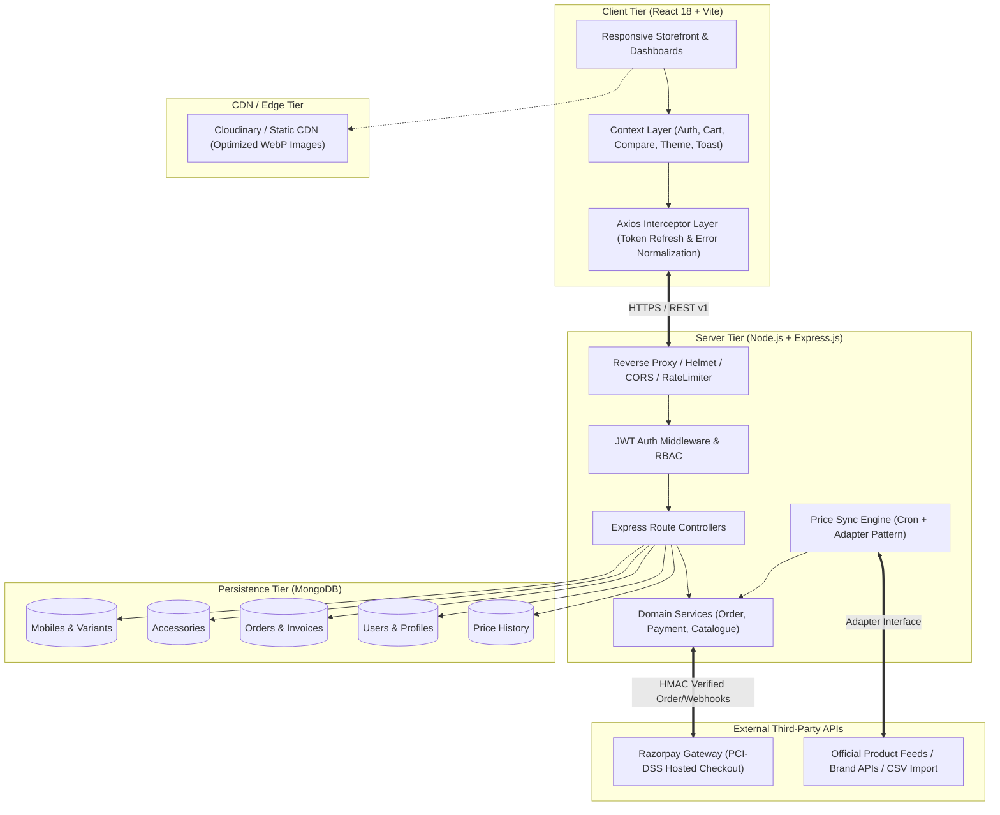
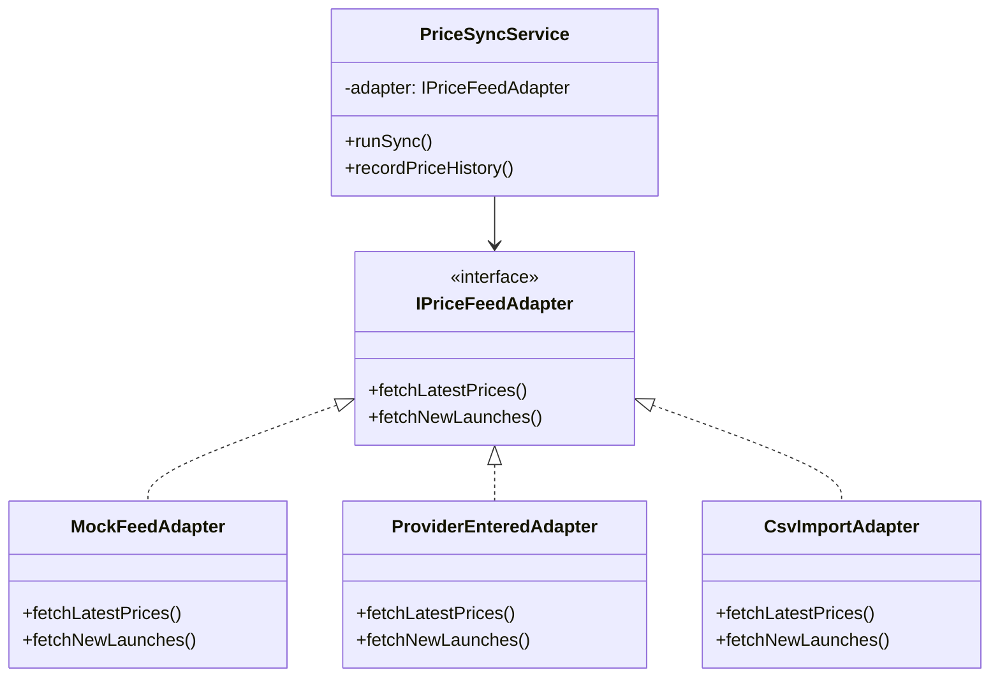
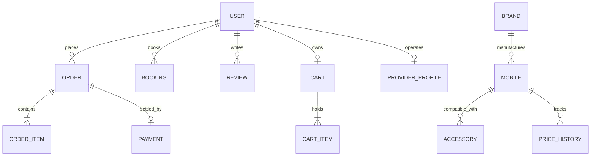

# MobiVerse India — System Architecture & Design

MobiVerse India is designed as a modular, scalable, multi-tier MERN web marketplace built specifically for the Indian smartphone ecosystem. It unifies phone research, real-time variant pricing, compatible accessory pairing, doorstep repair bookings, and secure payment processing.

---

## 1. System Topology & Tier Architecture

---

## 2. Core Subsystems

### 2.1 Multi-Role Authentication & Access Control (RBAC)
- **Roles**:
  - `visitor`: Unauthenticated browser; read-only access to catalogue, specs, and comparison engine.
  - `customer`: Authenticated buyer; manage cart, wishlist, profile addresses, orders, reviews, and doorstep repair bookings.
  - `provider`: Service provider or authorized seller; create and manage listings, service offerings, and fulfill incoming orders.
  - `admin`: Platform operator; user moderation, provider verification, catalogue approval, price-sync triggering, and marketplace analytics.
- **Token Security**: Dual-token pattern using short-lived JWT access tokens (15 minutes) paired with cryptographically secure refresh tokens stored in `httpOnly`, `Secure`, `SameSite: strict/lax` cookies. Access tokens are passed via the standard `Authorization: Bearer <token>` header.

### 2.2 Dynamic Catalogue & Specs Data Model
Every Indian-market mobile model encapsulates:
- Full hardware specifications: Chipset/processor (AnTuTu score), display (refresh rate, panel type, resolution), battery (capacity, charging wattage, wireless charging), 5G Indian network bands (`n28`, `n78`, etc.), and camera sensor configurations.
- Multi-variant matrix: Multiple RAM/Storage/Color combinations with individual stock levels, SKUs, and Indian Rupee (INR) MRP and selling prices.
- Price integrity: Orders never trust client-submitted prices; totals and 18% Indian GST breakups are calculated directly from verified database records.

### 2.3 Plug-and-Play Price-Sync Engine (Adapter Pattern)
To ensure price freshness without violating external site scraping policies, the engine uses the GoF Adapter Pattern:

- **Scheduled Synchronization**: Managed by `node-cron` running at scheduled intervals (`0 */6 * * *`).
- **Audit Logging**: Price shifts generate immutable records in the `PriceHistory` collection, allowing customers to view "Price updated X hours ago" badges and price trends.
- **Review Queue**: Newly imported phone models are automatically flagged as `pending_review` until verified by an administrator.

### 2.4 Zero-PII Payment Gateway Integration (Razorpay)
- **Zero Card Storage**: In compliance with RBI and PCI-DSS mandates, the platform **never** receives, touches, or stores customer credit/debit card numbers, CVVs, net banking credentials, or UPI PINs.
- **Checkout Flow**:
  1. Client sends order request to `/api/v1/orders`.
  2. Server verifies DB prices, computes Indian GST, creates pending order record.
  3. Server invokes Razorpay API to generate an authoritative `order_id`.
  4. Client receives `order_id` and mounts Razorpay Standard Checkout overlay.
  5. Upon user authorization, Razorpay transmits `razorpay_payment_id` and signature.
  6. Server cryptographically verifies the SHA256 HMAC signature `HMAC_SHA256(order_id + "|" + payment_id, secret)`.
  7. Asynchronous Razorpay webhooks (`order.paid`, `payment.captured`) act as an idempotent fallback.

---

## 3. Database Schema Entity Relationships

